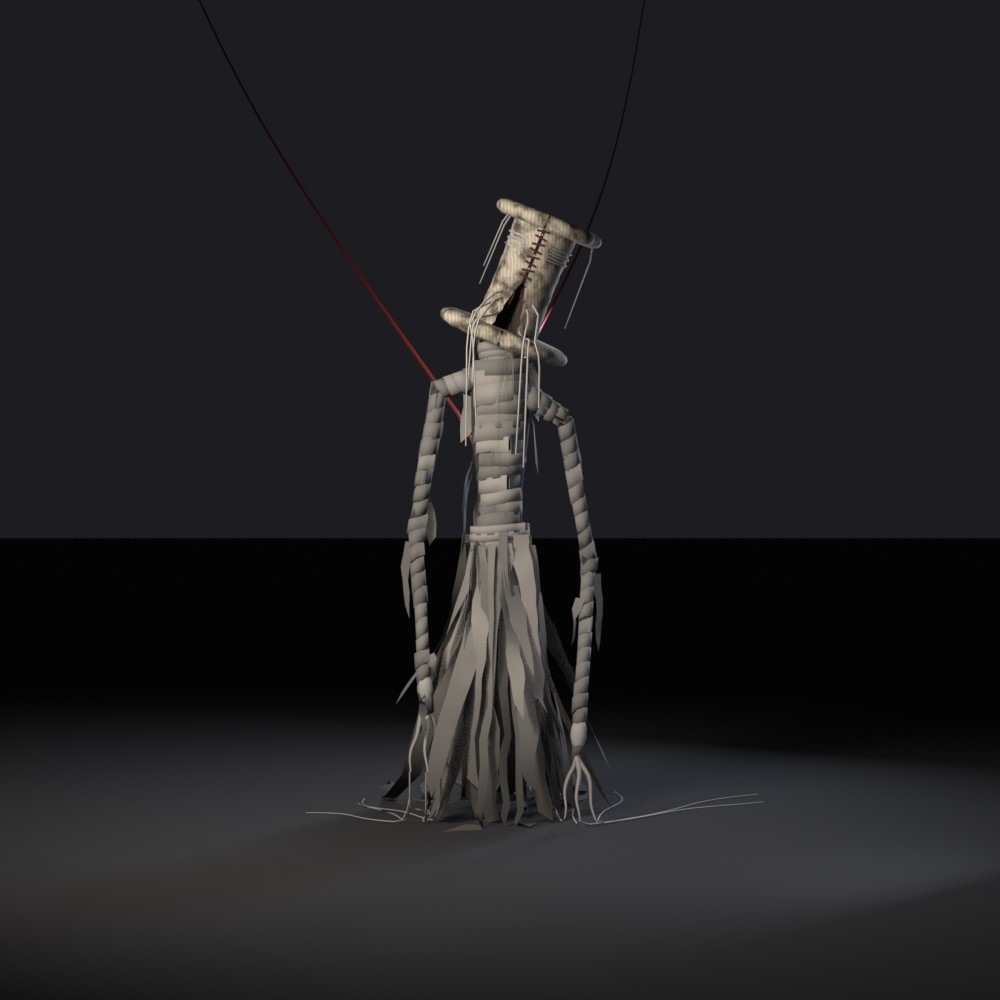
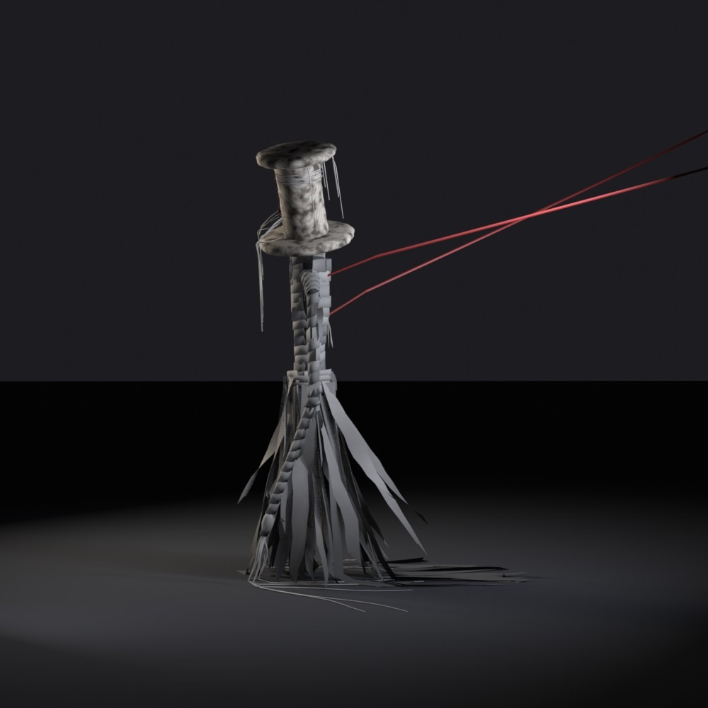
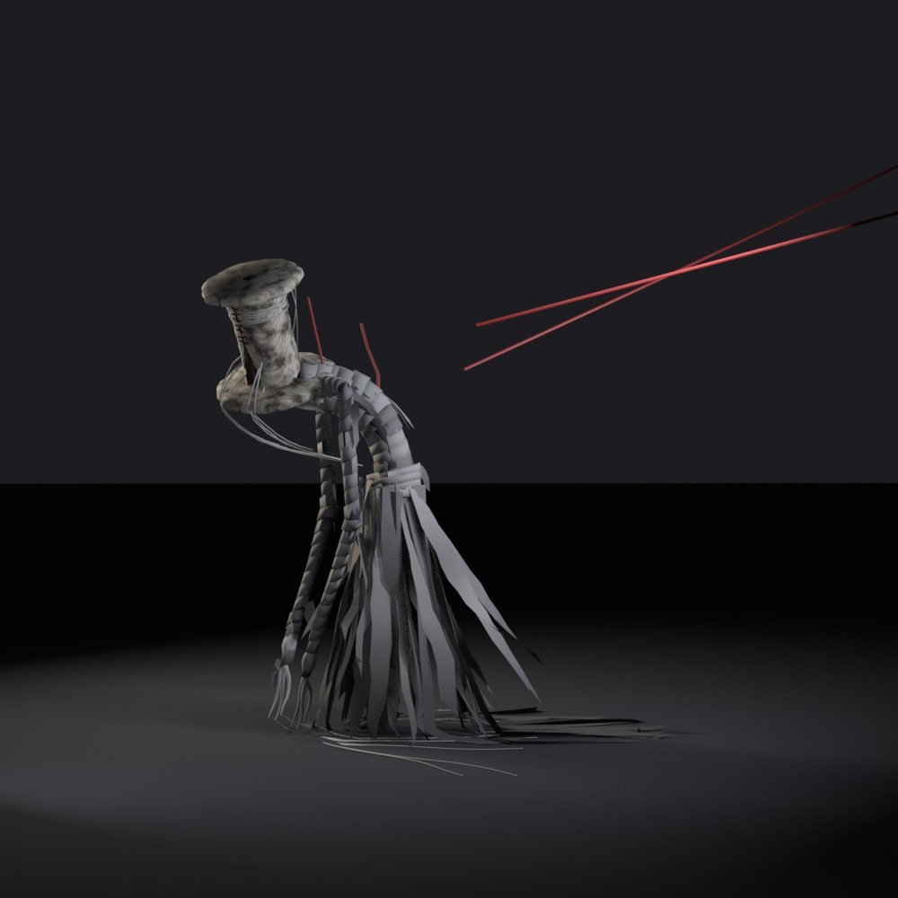
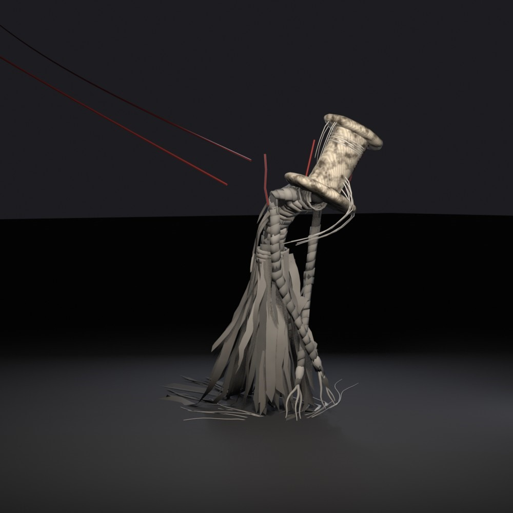
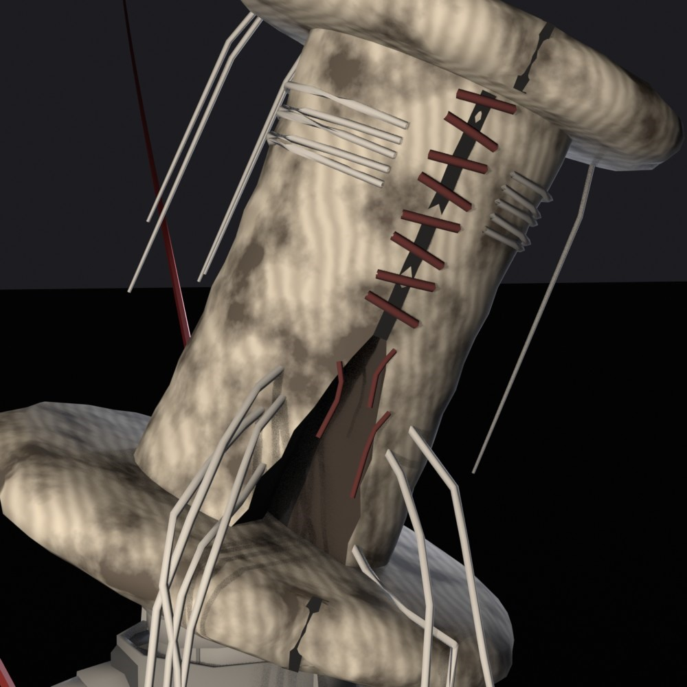

# The Mender

Character model renders of **the Mender**, a gaunt stitched figure with a thread-spool top hat, a frayed-cloth body, and red thread running from its neck.

## Renders

| Front (rest) | Side (rest) |
|---|---|
|  |  |

| Side (hunched) | Three-quarter (hunched) |
|---|---|
|  |  |

**Hat detail**

## About

I'm a bug hunter / QA tester who also does prompt engineering and AI-assisted rapid prototyping. I'm open to modelling and testing work for Roblox games.
